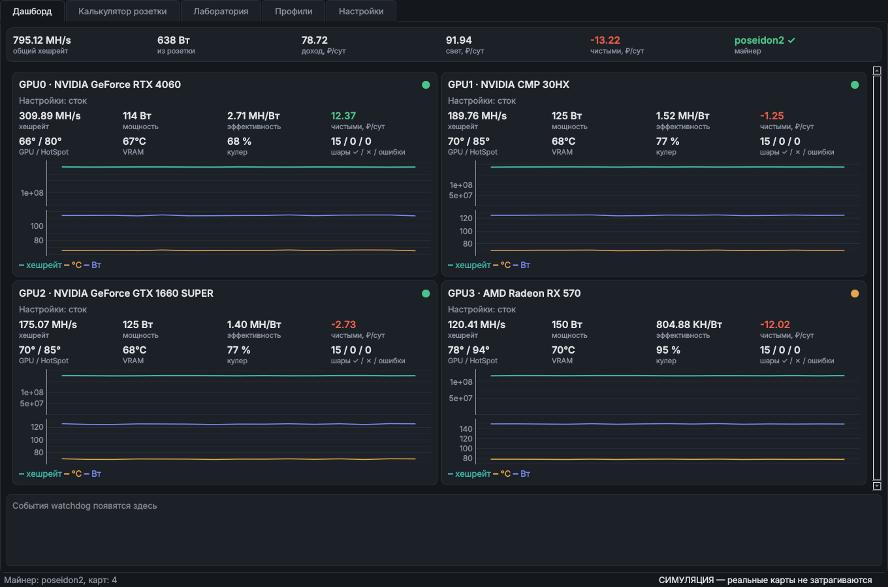
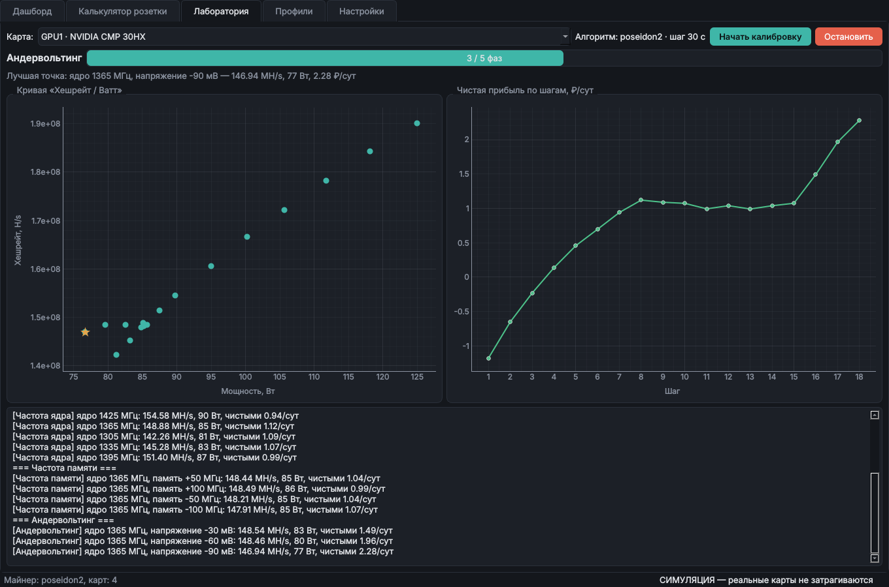
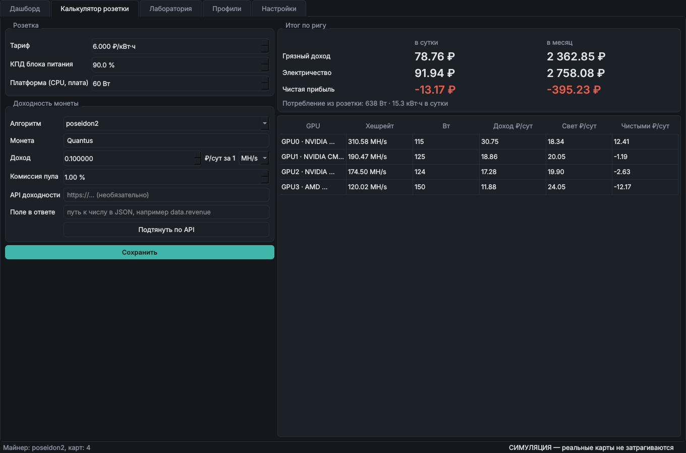

# HashBoost

Десктопное приложение для автоматического андервольтинга, разгона и оптимизации доходности видеокарт в реальном времени с учётом стоимости электроэнергии.

HashBoost работает как надстройка над майнером (SRBMiner-MULTI, Rigel / PeakMiner и другими с JSON API). Вместо ручного подбора частот в MSI Afterburner программа сама проводит серию замеров для каждой карты на конкретном алгоритме и находит точку **максимальной чистой прибыли**, а не максимального хешрейта: там, где дальнейший разгон приносит меньше денег, чем сжигает электричества.



## Возможности

| Модуль | Что делает |
|---|---|
| **Smart Auto-Tune** | Пошагово меняет частоту ядра (curve lock), памяти и напряжение через NVML (NVIDIA) и ADL (AMD), ждёт стабилизации хешрейта и фиксирует замеры |
| **Profit-per-Watt Engine** | Тариф за кВт·ч, КПД блока питания, потребление платформы, доходность монеты (вручную или по API) → доход, расходы на свет и чистая прибыль в сутки и месяц |
| **Интеграция с майнерами** | Телеметрия по локальному API: текущий и средний хешрейт, принятые / отклонённые / устаревшие шары, аппаратные ошибки |
| **Health Monitor** | Температуры GPU, HotSpot и VRAM, кулеры, потребление каждой карты и рига |
| **Watchdog** | При ошибках вычислений откатывает карту на последние стабильные настройки, при отвале перезапускает майнер, при перегреве снижает лимит мощности |
| **Менеджер профилей** | Лучший пресет для каждой карты под каждый алгоритм, переключение в один клик |

## Как работает калибровка

1. **Базовый замер** на стоковых настройках: хешрейт, потребление, прибыль.
2. **Частота ядра.** Частота фиксируется (curve lock) и сдвигается грубым шагом вниз от стока, пока растёт чистая прибыль; если снижение не помогает, проверяется разгон вверх. Затем лучшая точка уточняется мелким шагом (по умолчанию 15 МГц).
3. **Частота памяти.** Смещение вверх, пока растёт прибыль и нет ошибок; если выигрыша нет, проверяется снижение (для алгоритмов, зависящих от ядра, это экономит ватты).
4. **Андервольтинг.** При зафиксированной частоте напряжение снижается до порога нестабильности (сначала крупно, потом шагом 10 мВ), затем возвращается на запас надёжности (по умолчанию +20 мВ).
5. **Проверка.** Длинный замер итоговых настроек. Если появились ошибки, добавляется ещё запас.
6. **Сохранение профиля** индивидуально для карты (учёт «кремниевой лотереи») и алгоритма.

Каждый шаг: применить настройки → прогрев (20 с) → замер в течение окна стабилизации (90 с по умолчанию, настраивается). Шаг считается нестабильным при аппаратных ошибках, отвале карты, перегреве, пропаже API майнера, росте отклонённых шар или проседании хешрейта. После нестабильного шага настройки сразу откатываются на последний стабильный, при отвале майнер перезапускается.



### Андервольт на NVIDIA

NVML не даёт задавать напряжение напрямую, поэтому используется тот же приём, что и curve lock в Afterburner: частота ядра фиксируется через `nvmlDeviceSetGpuLockedClocks`, а V/F-кривая поднимается положительным смещением (`nvmlDeviceSetGpcClkVfOffset`). Карта держит ту же частоту на меньшем напряжении. Смещение напряжения в мВ переводится в смещение кривой коэффициентом `tuning.nvidia_mhz_per_mv` (по умолчанию 1,2 МГц на мВ).

## Установка и запуск

Нужен Python 3.10+.

```bash
pip install -e .
hashboost                 # обычный запуск
hashboost --simulate      # симулятор рига: RTX 4060, CMP 30HX, GTX 1660 SUPER, RX 570
```

Изменение частот и напряжений требует прав администратора (Windows) или root (Linux). Без них программа покажет телеметрию, но применить настройки не сможет.

Если видеокарты не найдены, HashBoost сам переходит в режим симуляции. В симуляции время ускорено в 30 раз (`--time-scale`), так что полная калибровка карты занимает пару минут вместо 40–50.

Калибровка без интерфейса:

```bash
hashboost --tune 0 --algorithm poseidon2
```

## Настройка майнера

Во вкладке **Настройки** выберите тип майнера и адрес API.

| Майнер | Как включить API | Адрес по умолчанию |
|---|---|---|
| SRBMiner-MULTI | `--api-enable --api-port 21550` | `http://127.0.0.1:21550` |
| Rigel / PeakMiner | `--api-bind 127.0.0.1:5000` | `http://127.0.0.1:5000` |
| Другой | любой JSON API, пути к полям задаются в `miner.json_map` | — |

Если указать путь к исполняемому файлу майнера, HashBoost будет сам запускать и перезапускать его. Если оставить пустым, майнер запускается вручную, а программа только читает его API.

Пример `json_map` для произвольного майнера:

```json
{"gpus": "devices", "index": "id", "hashrate": "speed", "accepted": "shares.ok",
 "rejected": "shares.bad", "invalid": "hw", "algorithm": "algo"}
```

## Калькулятор розетки



Доходность монеты задаётся как доход в валюте за сутки с единицы хешрейта (например, ₽ за 1 MH/s). Её можно подтягивать по API: укажите URL, который отдаёт JSON, и путь к числу в ответе (например, `data.0.revenue`).

## Где хранятся данные

| ОС | Папка |
|---|---|
| Windows | `%APPDATA%\HashBoost` |
| Linux | `~/.config/hashboost` |

Там лежат `config.json` (настройки), `profiles.json` (профили) и `hashboost.log`. Папку можно переопределить переменной окружения `HASHBOOST_HOME`.

## Структура проекта

```
hashboost/
  hardware/      драйверы: NVML (NVIDIA), ADL OverdriveN (AMD), симулятор рига
  miners/        клиенты API: SRBMiner, Rigel/PeakMiner, универсальный JSON; управление процессом
  core/
    profit.py    расчёт дохода, расходов и лучшей точки
    autotune.py  цикл калибровки
    watchdog.py  Health Monitor и Watchdog
    profiles.py  хранение профилей
    runtime.py   опрос телеметрии и связка модулей
  gui/           PySide6: дашборд, калькулятор, лаборатория, профили, настройки
tests/           тесты ядра на симуляторе
```

## Тесты

```bash
pip install -e ".[dev]"
pytest
```

## Ограничения текущей версии

* AMD поддерживается через ADL OverdriveN (Polaris / Vega, например RX 570). Для RDNA (RX 5000+) нужен Overdrive8, он в планах.
* Форматы API майнеров разобраны по документации и терпимы к отсутствию полей, но на реальных версиях их стоит сверить. При расхождении можно переключиться на универсальный JSON-клиент.
* Калибровка идёт по одной карте за раз (остальные продолжают майнить).
* Готового установщика (.exe) пока нет.
